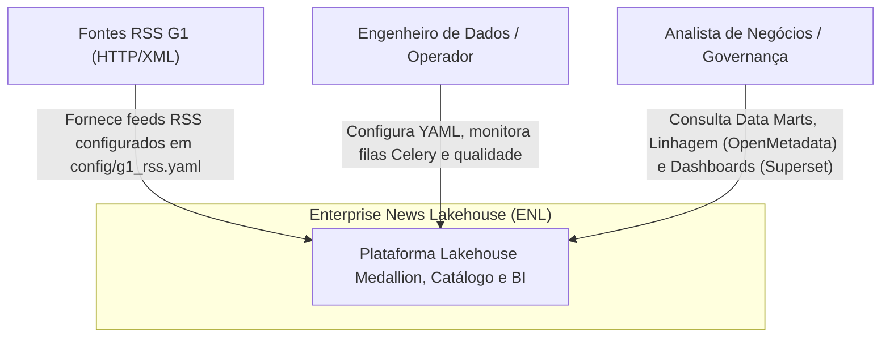
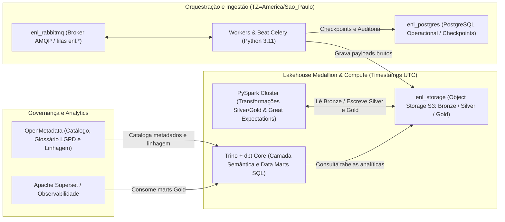

# Arquitetura C4 (C1/C2), Inventário do Docker Compose e Plano de Isolamento — Etapa 1

## 1. Inventário do Docker Compose Existente

O arquivo `docker-compose.yaml` na raiz do workspace (`name: enterprise-news-lakehouse`) foi inspecionado integralmente. Todos os **14 serviços existentes** foram preservados sem remoção ou alteração destrutiva de volumes, redes ou portas:

| Serviço Existente | Imagem / Build | Rede / IP Fixo | Portas Host | Bind Mounts Existentes | Profile |
|---|---|---|---|---|---|
| `rabbitmq` | `rabbitmq:4-management` | `172.28.50.10` | `5672`, `15672` | `./rabbitmq_data:/var/lib/rabbitmq` | padrão |
| `storage` | `rustfs/rustfs:1.0.0-alpha.83` | `172.28.50.28` | `9000`, `9001` | `./storage-data:/data` | `servico_ml` |
| `app` | `scripts_dockerfile/app_prometheus.Dockerfile` | `172.28.50.20` | `8000` | `./prometheus_multiproc:/tmp/prometheus` | padrão |
| `worker_celery_beat` | `scripts_dockerfile/celery.Dockerfile` | `172.28.50.21` | — | `./app`, `./prometheus_multiproc`, `./celerybeat_data` | padrão |
| `worker_rss_ingestion` | `scripts_dockerfile/celery.Dockerfile` | `172.28.50.22` | — | `./app`, `./prometheus_multiproc` | padrão |
| `worker_rss_processar_noticia` | `scripts_dockerfile/celery.Dockerfile` | `172.28.50.23` | — | `./app`, `./prometheus_multiproc` | padrão |
| `worker_monitoramento` | `scripts_dockerfile/celery.Dockerfile` | `172.28.50.24` | — | `./app`, `./prometheus_multiproc` | padrão |
| `flower` | `mher/flower:latest` | `172.28.50.25` | `5555` | `./flower_data:/data` | padrão |
| `prometheus` | `prom/prometheus` | `172.28.50.26` | `9090` | `./vl_prometeus/prometheus.yml`, `./prometheus_data` | padrão |
| `grafana` | `grafana/grafana` | `172.28.50.27` | `3000` | `./grafana_data:/var/lib/grafana` | padrão |
| `trino` | `trinodb/trino:484` | `172.28.50.30` | `8080` | `./trino_catalog`, `./trino_data` | padrão |
| `spark-master` | `apache/spark:3.5.6` | `172.28.50.31` | `7077`, `8082:8080` | `./spark_jobs`, `./spark_master_data` | padrão |
| `spark-worker` | `apache/spark:3.5.6` | `172.28.50.32` | `8083:8081` | `./spark_jobs`, `./spark_worker_data` | padrão |
| `pyspark` | `apache/spark:3.5.6` | `172.28.50.33` | — | `./spark_jobs`, `./spark_client_data` | `spark-tools` |

## 2. Mapeamento de Conflitos e Plano de Isolamento

1. **Conflito de diretórios de volume**: Os serviços pré-existentes utilizam diretórios soltos na raiz (`./rabbitmq_data`, `./storage-data`, `./trino_data`, etc.). As regras do Enterprise News Lakehouse determinam que todos os dados persistentes dos novos serviços exclusivos residam sob `./volumes/enl_*` na raiz do projeto, sem remover os diretórios antigos.
2. **Conflito de filas e broker RabbitMQ**: Os workers legados em `./app/celery_app.py` usam filas sem prefixo (`rss_ingestion`, `processar_noticia`, `fila_monitoramento`) e o vhost `news_lakehouse` na porta `5672`. Para isolamento total:
   - Adicionamos `enl_rabbitmq` (portas `5673`/`15673`, IP `172.28.50.40`, vhost `enl_vhost`, volume `./volumes/enl_rabbitmq`).
   - Todas as filas Celery do projeto utilizam o prefixo exclusivo `enl.*` (ex.: `enl.rss.ingestion`, `enl.medallion.bronze`).
3. **Banco PostgreSQL operacional exclusivo**:
   - Adicionamos `enl_postgres` (`postgres:16-alpine`, porta host `5433`, IP `172.28.50.41`, banco `enl_operacional`, volume `./volumes/enl_postgres`).
4. **Object Storage compatível com S3 exclusivo**:
   - Adicionamos `enl_storage` (`rustfs/rustfs:1.0.0-alpha.83`, portas host `9010`/`9011`, IP `172.28.50.42`, volume `./volumes/enl_storage`).
5. **Fuso horário e persistência**:
   - Todos os serviços exclusivos definem `TZ=America/Sao_Paulo`, enquanto os timestamps analíticos das camadas Bronze/Silver/Gold são normalizados e persistidos em `UTC`.

## 3. Diagrama C4 — Nível 1 (Contexto do Sistema - C1)

## 4. Diagrama C4 — Nível 2 (Containers - C2)

